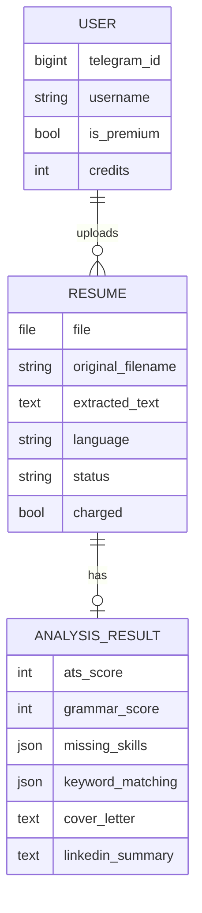

# AI Resume Analyzer

[](https://github.com/Lochinbek-Rasuljonov/ai-resume-analyzer/actions/workflows/tests.yml)

A Telegram Mini App that reviews resumes with Google Gemini. A user uploads a PDF or DOCX file and gets:

- an ATS score and scores for grammar, readability and professionalism
- missing skills and keyword matches
- notes on experience and education, with concrete suggestions
- a rewritten resume, a cover letter, a LinkedIn summary and interview tips

The answers come in Uzbek, Karakalpak, Russian or English.

## Stack

- **Backend:** Python, Django, Django REST Framework, SimpleJWT, PostgreSQL
- **Background jobs:** Celery with Redis. A Gemini analysis takes 10–30 seconds, so it runs in a worker while the app polls for the result.
- **Frontend:** React, TypeScript, Vite, TanStack Query, Framer Motion, served by nginx
- **Telegram:** a Mini App, plus a small bot (pyTelegramBotAPI) that opens it
- **Deployment:** Docker Compose with six services: frontend, backend, Celery worker, Telegram bot, PostgreSQL and Redis

## How it works

1. **Login.** The Mini App sends Telegram's signed `initData`. The backend checks its HMAC signature with the bot token and refuses data older than 24 hours. It then creates or updates the user and returns JWT tokens.
2. **Upload.** The backend accepts only PDF and DOCX files up to 10 MB and reads the text right away. A file with no readable text is refused and costs nothing. Every user gets 3 free analyses; the credit is taken with a single conditional `UPDATE`, so parallel uploads can't overspend.
3. **Analysis.** A Celery task asks Gemini for two JSON answers (the evaluation, then the rewritten documents) using Gemini's JSON response mode. Scores are clamped to 0–100. If anything fails, the resume is marked `FAILED` and the credit is given back.
4. **Results.** The dashboard polls every 3 seconds while an analysis is running and shows each finished resume's ATS score.

## API

| Method | Path | What it does |
|---|---|---|
| `POST` | `/api/users/auth/telegram/` | Log in with Telegram `initData`, returns JWT tokens |
| `POST` | `/api/users/auth/refresh/` | Get a new access token |
| `GET` | `/api/users/me/` | Current user and remaining credits |
| `GET` | `/api/resumes/` | The user's resumes with status and ATS score |
| `POST` | `/api/resumes/` | Upload a resume (`file`, `language`); starts the analysis |
| `GET`, `DELETE` | `/api/resumes/{id}/` | One resume, or delete it with its file |
| `GET` | `/api/analysis/{resume_id}/` | The full analysis once it is finished |

## Data model



## Run it

```bash
git clone https://github.com/Lochinbek-Rasuljonov/ai-resume-analyzer.git
cd ai-resume-analyzer
cp backend/.env.example backend/.env   # fill in SECRET_KEY, TELEGRAM_BOT_TOKEN, WEBAPP_URL, GEMINI_API_KEY
docker compose up --build -d
```

The frontend runs on `http://localhost:5173` and the API on `http://localhost:8000`. Telegram only opens Mini Apps over HTTPS, so `WEBAPP_URL` must be a public HTTPS address of the frontend, for example a tunnel during development.

To open the frontend in a normal browser during development, print signed test `initData` and give it to Vite:

```bash
cd backend && python manage.py dev_init_data        # needs TELEGRAM_BOT_TOKEN
cd ../frontend && VITE_DEV_INIT_DATA='<printed value>' npm run dev
```

## Tests

```bash
cd backend && SECRET_KEY=test python manage.py test
cd frontend && npm run lint && npm run build
```

The backend tests cover the Telegram signature check (forged, tampered, old and foreign-bot data are refused), uploads, credits and refunds, access to other users' data, and the analysis task with a mocked Gemini client. GitHub Actions runs everything on every push.
