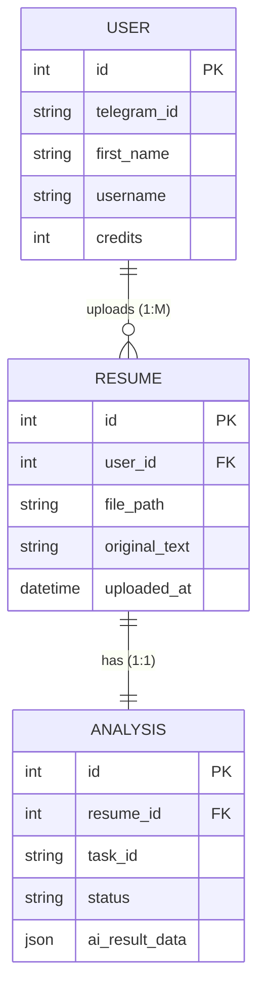

# AI Resume Analyzer

## 1. Loyihaning umumiy tavsifi (Overview)
**Muammo va Yechim:**  
Ish qidiruvchilar ko'pincha o'z rezyumelarini qanday yaxshilashni yoki ATS (Applicant Tracking System) tizimlaridan qanday qilib muvaffaqiyatli o'tishni bilishmaydi. "AI Resume Analyzer" foydalanuvchilarning PDF/DOCX formatdagi rezyumelarini qabul qilib, Google Gemini AI yordamida chuqur tahlil qiladi. Tizim rezyume uchun ATS balini hisoblaydi, yetishmayotgan kalit so'zlarni topadi, grammatik xatolarni ko'rsatadi va avtomatik tarzda yangilangan rezyume matni, Cover Letter hamda LinkedIn xulosasini tayyorlab beradi. Bu loyiha Telegram Mini App ko'rinishida ishlangan bo'lib, foydalanuvchilarga eng oson va zamonaviy interfeysni taqdim etadi.

**Loyiha roli:**  
**Solo/Lead Developer (Full Stack Engineer)** – Men ushbu loyihaning arxitekturasini loyihalashtirishdan tortib, frontend qismini (React/TypeScript), asinxron ishlashga moslashtirilgan backend tizimini (Django/Celery/Redis) qurish va sun'iy intellekt (Gemini) integratsiyasi hamda Telegram bot sozlamalari, Docker yordamida serverga joylash ishlarini to'liq o'zim amalga oshirdim.

## 2. Texnologiyalar steki (Tech Stack)
- **Asosiy Til va Freymvorklar:** Python, Django, Django REST Framework (DRF) — orqa qism API larini qurish va boshqarish uchun; React (Vite), TypeScript, Framer Motion — zamonaviy, tezkor va chiroyli animatsiyalarga ega Frontend uchun.
- **Ma'lumotlar bazasi:** PostgreSQL — relyatsion ma'lumotlarni ishonchli va tez saqlash uchun tanlandi (SQLite ga qaraganda production muhiti uchun kuchliroq va parallel so'rovlarni oson boshqaradi).
- **Kesh va Navbatlar (Caching & Message Broker):** Redis va Celery — AI modeliga (Gemini) qilingan so'rovlar odatda 10-30 soniya vaqt oladi. Ushbu asinxron ishlarni background'ga o'tkazish (navbatga qatorlash) va natijani vaqtincha saqlash uchun qullanildi.
- **Konteynerizatsiya va Deploy:** Docker, Docker Compose, Nginx — Loyihaning barcha xizmatlarini (frontend, backend, celery, redis, db) izolyatsiyada, xatosiz ishga tushirish uchun Docker ishlatildi. Nginx esa reverse-proxy vazifasini bajaradi.
- **Uchinchi tomon integratsiyalari:** 
  - **Google Gemini AI API** — rezyume matnini semantik va chuqur tahlil qilish uchun.
  - **Telegram Bot API** — Mini App interfeysini integratsiya qilish uchun.

## 3. Texnik murakkabliklar va Yechimlar (Engineering Challenges)
**Qiyin vazifa:**  
Rezyumelarni Gemini AI orqali tahlil qilish juda katta hajmdagi tekstni o'qib, analiz qilib, keng qamrovli JSON javob qaytarishni talab qiladi. Bu jarayon 15-30 soniya davom etishi mumkin. Agar tahlil sinxron (oddiy HTTP so'rov ko'rinishida) qilinganda, foydalanuvchi interfeysi (UI) qotib qolardi va server "Timeout" xatoligini berardi. Eng yomoni, bir vaqtning o'zida bir nechta foydalanuvchi ishlatsa, tizim qulab tushishi mumkin edi.

**Sizning yechimingiz:**  
Tizim arxitekturasini to'liq asinxron ishlashga moslashtirdim. Rezyume yuklanganda, API uzoq kutib turmasdan darhol javob (Task ID) qaytaradi. Barcha og'ir tahlil qilish jarayonlarini **Celery va Redis** yordamida "Background Worker" larga topshirdim. Frontend esa belgilangan Task ID orqali "polling" qilib, statusni tekshirib turadi va jarayon (Processing -> Completed) tugagan zahotiyoq natijani silliq animatsiya bilan ekranga chiqaradi. Bu yechim tufayli API so'rovlarni qabul qilish tezligi millisoniyalarga tushdi, "Timeout" larning oldi olindi va server katta yuklamalarga chidamli holatga keltirildi.

## 4. Tizim arxitekturasi va Ma'lumotlar bazasi sxemasi (Database Schema)
Ma'lumotlar bazasi asosan quyidagi 3 ta asosiy jadvaldan (One-to-Many va One-to-One munosabatlari) tashkil topgan:



## 5. Loyiha statistikasi (Stats & Metrics)
- **Mikroservislar (Konteynerlar):** 5 xil xizmat (Frontend, Backend, Postgres, Redis, Celery).
- **API Endpoints:** Loyiha davomida jami 10 dan ortiq RESTful API endpointlar yaratilgan (fayl yuklash, autentifikatsiya, statusni asinxron tekshirish, natijalarni olish, foydalanuvchi ma'lumotlarini tahrirlash).
- **Qator kodlar (Lines of Code):** ~5K+ (Frontend interfeys va Backend logikasi to'liq yozib chiqilgan).

## 6. API Hujjatlari (API Documentation)
Loyihaning Backend qismi toza REST API arxitekturasida yozilgan. Frontend ham aynan shu tizimda ishlaydi:
- `POST /api/resumes/upload/` -> rezyume yuborish, asinxron Celery Task ishga tushadi (Response: `task_id` va `202 Accepted`).
- `GET /api/analysis/status/{task_id}/` -> backend ish holatini qaytaradi (`PENDING`, `PROCESSING`, `COMPLETED`, `FAILED`).
- `GET /api/analysis/result/{task_id}/` -> tahlil muvaffaqiyatli tugasa, Gemini dan olingan JSON ma'lumotlarni (ATS bali, xatolar, tavsiyalar) taqdim etadi.

## 7. Loyihani ishga tushirish (Installation & Setup)
Loyihani o'z kompyuteringizda yoki serverda osongina ishga tushirish uchun Docker yordam beradi:

```bash
# 1. Repozitoriyni yuklab olish
git clone https://github.com/Lochinbek-Rasuljonov/ai-resume-analyzer.git
cd ai-resume-analyzer

# 2. Atrof-muhit o'zgaruvchilarini (.env) sozlash
# backend/.env faylini oching va quyidagi o'zgaruvchilarni kiriting:
# TELEGRAM_BOT_TOKEN=...
# GEMINI_API_KEY=...
# WEBAPP_URL=...

# 3. Docker orqali birgina buyruq bilan barcha 5 ta konteynerni ishga tushirish:
docker-compose up --build -d
```
Loyiha ishga tushgach, tizim avtomatik tarzda `http://localhost:5173` (Frontend) va `http://localhost:8000` (Backend) portlarida ishlaydi.

## 8. Havolalar (Links)
- **GitHub Repository:** [https://github.com/Lochinbek-Rasuljonov/ai-resume-analyzer](https://github.com/Lochinbek-Rasuljonov/ai-resume-analyzer)
- **Live Demo:** Telegram Mini App tarmog'ida ishlab turibdi.
